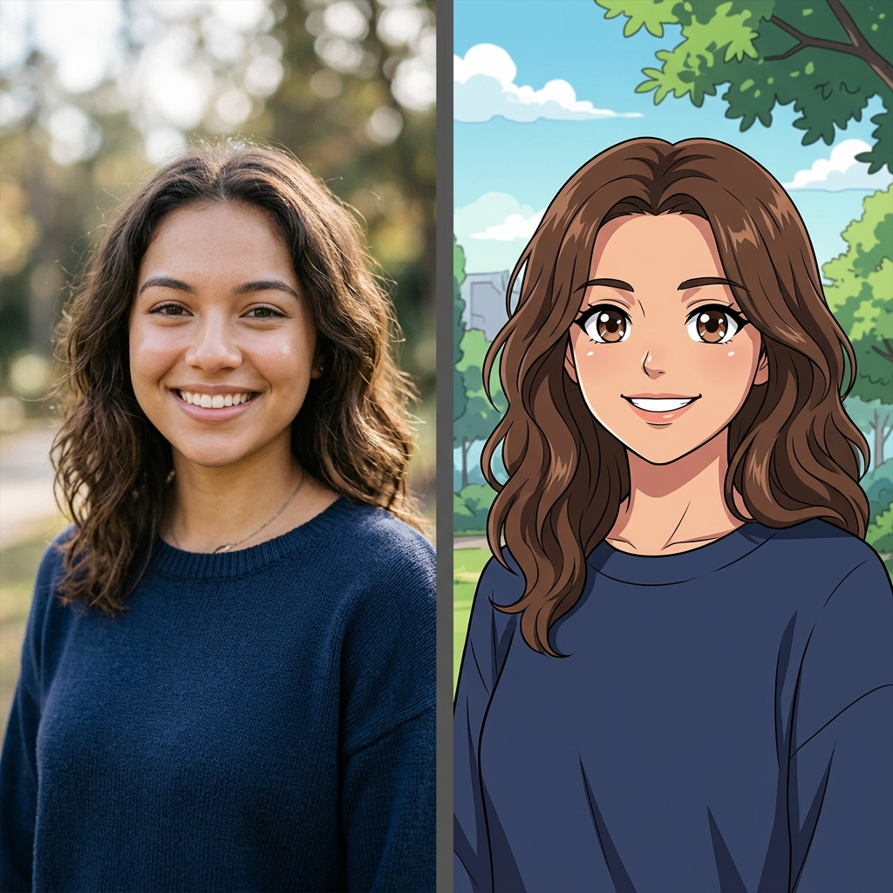
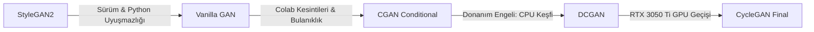
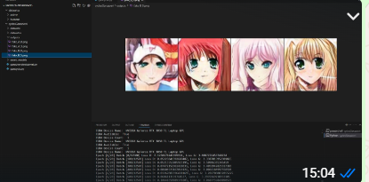

<div align="center">

# 🎨 Face2Anime-CycleGAN: Human Face <-> Anime Face Translation

[](https://www.tensorflow.org/)
[](https://www.python.org/)
[](https://opensource.org/licenses/MIT)
[](https://www.nvidia.com/)

**GAN Modelleri Kullanılarak İnsan Yüz Verilerinin Anime Karakterlerine Dönüştürülmesi**  
*Derinlemesine Araştırma, Model Denemeleri, Donanım Optimizasyonu ve CycleGAN Uygulaması*

<br/>



*Gerçek İnsan Yüzü $\leftrightarrow$ Anime Portresi Dönüşümü (Side-by-Side Comparison)*

</div>

---

## 📖 Projenin Doğuşu ve Geliştirme Günlüğü (Sprint Hikayesi)

Bu proje, hazır modelleri doğrudan çalıştırmak yerine, **farklı GAN mimarilerini, veri büyüklüklerini ve donanım sınırlarını test ederek** en iyi sonuca ulaşmayı amaçlayan kapsamlı bir yapay zeka araştırma ve geliştirme sürecinin ürünüdür.

### 🔍 1. Aşama: 7 Adımlı Kapsamlı Araştırma Süreci (3-4 Gün)

1. **Mevcut Pazar Analizi:** İnsan yüzlerini animeleştiren popüler platformlar (*Anime Genius, neural.love, Fotor, Anime Myself*) incelendi; arka planda kullandıkları mimari kurgular ve dönüşüm yaklaşımları araştırıldı.
2. **GAN Mimarileri ve Parametre Raporlaması:** Üretici ve ayırt edici ağların hiperparametreleri, kayıp fonksiyonları ve stabiliteleri detaylı şekilde raporlandı.
3. **Açık Kaynak & GitHub İncelemesi:** GitHub üzerindeki açık kaynaklı GAN projeleri taranarak temiz kod (clean code), modülerlik ve kod mimarisi yaklaşımları analiz edildi.
4. **Veri Seti Araştırması & Büyüme:** İlk başta **36.000 görsel** ile başlayan veri arayışı, filtreleme ve temizleme adımlarıyla **140.000 görsele** kadar genişletildi.
5. **Kütüphane & Teori Araştırması:** Python derin öğrenme ekosistemindeki temel yapılar (*PyTorch, Torchvision, TensorFlow, Keras, NumPy, Matplotlib*) teorik ve pratik olarak incelendi.
6. **Modüler Kod Mimarisi Tasarımı:** Veri hattı, model katmanları, kayıp fonksiyonları ve eğitim döngüsünün birbirinden bağımsız modüller halinde yapılandırılması kararlaştırıldı.
7. **Uygulama ve Kodlama:** Araştırma çıktılarının kod bloklarına dökülmesi aşamasına geçildi.

---

### 🧪 2. Aşama: Model Denemeleri, Hatalar ve Mimari Evrimi

En iyi görsel kalitesini hangi modelin vereceğini bulmak için sırasıyla farklı GAN mimarileri test edildi:



#### ❌ Deneme 1: StyleGAN2 ve Kütüphane Sürüm Krizleri
- İlk aşamada İbrahim ile birlikte yüksek görsel kalitesi nedeniyle **StyleGAN2** ile başlama kararı alındı.
- VS Code üzerinde TensorFlow kullanılarak 100 veri ile ilk prototip denendi.
- Ancak TensorFlow'un StyleGAN2 gereksinimleriyle olan sürüm uyuşmazlıkları, Python 3.7 bağımlılıklarının artık kullanımdan kalkmış olması ve Anaconda ortamındaki kütüphane çakışmaları süreci tıkadı. Colab ve PyTorch denemelerinde de stabilite sağlanamadı.

#### ⚙️ Deneme 2: Vanilla GAN ve İlk Başarılı Çıktı (25 Temmuz)
- Karmaşık mimariler yerine GAN'ın temel mantığını doğrulamak adına Colab üzerinde PyTorch ile temel GAN modeli kuruldu.
- **100 veri ve 25 epoch** sonucunda ilk başarılı anime yüz çıktıları alındı.

#### 📉 Deneme 3: Büyük Veri (35.000 Görsel) & Colab Zaman Aşımları
- Veri seti 35.000 görsele çıkarıldı; ancak Colab ücretsiz sürümünün kısıtlı GPU süreleri, zaman aşımına uğraması, eğitimin yarıda kesilmesi ve ofis-ev arasındaki internet kopuklukları eğitimin tamamlanmasını engelledi.
- Veri sayısı 3.000'e çekilip epoch değerleriyle optimizasyon yapıldı ancak tam netliğe ulaşılamadı.

#### 🎯 Deneme 4: CGAN (Conditional GAN) ile 2 Günlük Eğitim
- Colab kesintilerinden dolayı yerel ortama (VS Code) dönüldü ve **CGAN** ile çalışıldı.
- Çıktılar temel GAN'a göre çok daha net ve kararlı hale geldi. Veri ve epoch sayısı artırılarak yaklaşık **2 gün süren kesintisiz bir eğitim** gerçekleştirildi.

#### 💡 Deneme 5: DCGAN ve Kritik Donanım Teşhisi (CPU vs GPU Keşfi)
- CGAN eğitiminin aşırı yavaş olması üzerine yeni bir dosyada **DCGAN** denendi.
- Bu aşamada sürecin yavaş ilerlemesinin asıl sebebi ortaya çıktı: **Kullanılan kişisel bilgisayarın harici NVIDIA GPU sürücüsü derin öğrenmeyle uyumlu değildi ve model farkında olmadan tüm eğitimi CPU üzerinde yapıyordu!**
- Bu kritik teşhis sonrasında donanım değiştirildi. İbrahim'in bilgisayarındaki **NVIDIA GeForce RTX 3050 Ti Laptop GPU** donanımına geçilerek hem CUDA desteği sağlandı hem de mimari nihai olarak **CycleGAN**'a taşındı.

---

### 🖼️ Gerçek Eğitim Süreci ve Donanım Çıktısı

Aşağıdaki görsel, modelin **NVIDIA GeForce RTX 3050 Ti Laptop GPU** üzerinde yerel olarak eğitildiği anı, VS Code terminalindeki kayıpları ve üretilen gerçek `fake_B` anime çıktılarını göstermektedir:

<div align="center">
  
  <p><em>NVIDIA RTX 3050 Ti üzerinde CycleGAN Eğitimi ve Üretilen Gerçek Anime Çıktıları</em></p>
</div>

---

### 📊 Veri Büyüklüğü Aşamaları ve Hedefler

| Aşama | Veri Sayısı | Donanım | Sonuç & Gözlem |
|---|---|---|---|
| **Aşama 1** | 2.000 Veri | RTX 3050 Ti | Yüz silüeti ve temel renkler başarıyla oluşmaya başladı. |
| **Aşama 2** | 10.000 Veri | RTX 3050 Ti | Göz, burun ve saç hatları belirginleşti, stil transferi oturdu. |
| **Aşama 3 (Aktif)**| **50.000 Veri** | RTX 3050 Ti | Yüksek detay, temiz gölgelendirme ve kararlı çevrim. |
| **Aşama 4 (Hedef)**| **600.000 Veri** | GPU Cluster / Cloud | Prodüksiyon seviyesinde, kayıpsız ve ultra keskin anime portreleri. |

---

## 🏗️ Teknik Mimari: Neden CycleGAN?

CycleGAN, eşleştirilmemiş (**unpaired**) iki görsel alanı arasında çift yönlü dönüşüm yapabilen en kararlı mimaridir:

```text
Gerçek İnsan (A) ----[ G_A2B ]----> Sahte Anime (B) ----[ G_B2A ]----> Yeniden Üretilen İnsan (A')
Gerçek Anime (B) ----[ G_B2A ]----> Sahte İnsan (A) ----[ G_A2B ]----> Yeniden Üretilen Anime (B')
```

### 🧠 Katman ve Kayıp Detayları:
- **ResNet-9 Generator:** Bilgi kaybını önleyen 9 adet Residual Blok içeren derin üreteç.
- **70x70 PatchGAN Discriminator:** Görselin tamamına değil, 70x70 piksellik yerel bölgelere odaklanarak ince anime dokularını denetleyen ayırt edici.
- **Identity Loss ($\lambda_{id} = 5.0$):** Cilt tonunun, saç renginin ve yüz kompozisyonunun gereksiz yere bozulmasını engelleyen kimlik kaybı.
- **Cycle Consistency Loss ($\lambda_{cyc} = 10.0$):** $A \to B \to A \approx A$ döngü tutarlılığı.
- **Dahili Instance Normalization:** Tüm modern TensorFlow sürümleriyle uyumlu, harici paket gerektirmeyen özel katman.
- **Lazy Loading `tf.data` Hattı:** 50.000+ görseli belleğe yığmadan GPU'ya anlık akıtan optimize veri boru hattı.

---

## 📁 Dizin Yapısı

```text
├── assets/                  # README ve eğitim vitrin görselleri
│   ├── sample_showcase.png  # Öncesi / sonrası vitrin görseli
│   └── training_process.png # RTX 3050 Ti terminal eğitimi ve çıktı ekranı
├── anime/                   # Anime yüzleri veri seti (.jpg, .png)
├── insan/                   # Gerçek insan yüzleri veri seti (.jpg, .png)
├── outputs/                 # Eğitim ve test çıktıları (epoch_xxx.png)
├── checkpoints/             # Model ağırlıkları (.weights.h5)
├── gancycle.py              # ResNet-9 + PatchGAN eğitim kodu
├── test.py                  # Tek görsel dönüştürme (Inference) betiği
├── colab_train.ipynb        # Google Colab GPU eğitim not defteri
├── requirements.txt         # Gerekli bağımlılıklar
├── .gitignore               # Büyük veri setlerini yok sayma kuralları
└── README.md                # Kapsamlı proje dokümantasyonu
```

---

## 🛠️ Kurulum

```bash
# 1. Repoyu klonlayın:
git clone https://github.com/senaozkann/Face2Anime-CycleGAN.git
cd Face2Anime-CycleGAN

# 2. Sanal ortam kurun ve etkinleştirin:
python -m venv venv
# Windows:
venv\Scripts\activate
# Linux/macOS:
source venv/bin/activate

# 3. Bağımlılıkları yükleyin:
pip install -r requirements.txt
```

---

## 🧪 Kendi Fotoğrafınızı Dönüştürme (Inference)

Eğitilmiş model ağırlıklarını kullanarak kendi fotoğrafınızı tek satırla animeye çevirebilirsiniz:

```bash
# İnsan fotoğrafını animeye çevirme (Yan yana öncesi/sonrası çıktısı üretir):
python test.py --input benim_fotografim.jpg --direction human2anime

# Anime portresini gerçekçi insan yüzüne çevirme:
python test.py --input anime_cizim.jpg --direction anime2human
```

---

## 🏋️ Eğitimi Başlatma

### Yerel GPU ile Eğitim:
```bash
python gancycle.py --epochs 50 --batch_size 1 --img_size 256 --human_dir ./insan --anime_dir ./anime
```

### Google Colab ile Ücretsiz T4 GPU Eğitimi:
1. Depo içerisindeki **[`colab_train.ipynb`](colab_train.ipynb)** dosyasını açın.
2. Üst menüden **Runtime $\to$ Change runtime type $\to$ T4 GPU** seçin.
3. Hücreleri sırayla çalıştırarak eğitiminizi başlatın.

---

## 📌 Yol Haritası (Roadmap)

- [x] Web siteleri ve GAN algoritmaları üzerine 7 adımlı araştırma
- [x] StyleGAN2, Vanilla GAN, CGAN ve DCGAN denemeleri
- [x] CPU darboğazının keşfi ve NVIDIA RTX 3050 Ti GPU geçişi
- [x] CycleGAN mimarisinin kurulması ve 2.000 veri ile doğrulama
- [x] 10.000 veri eğitimi ve kararlı çizgi hatları
- [/] **50.000 veri ile ileri düzey model eğitimi (Aktif)**
- [ ] 600.000 veri ile büyük ölçekli nihai eğitim
- [ ] Web arayüzü (Gradio / Streamlit) entegrasyonu ile canlı demo

---

## 📜 Lisans

Bu proje [MIT Lisansı](LICENSE) kapsamında açık kaynak olarak paylaşılmıştır.
